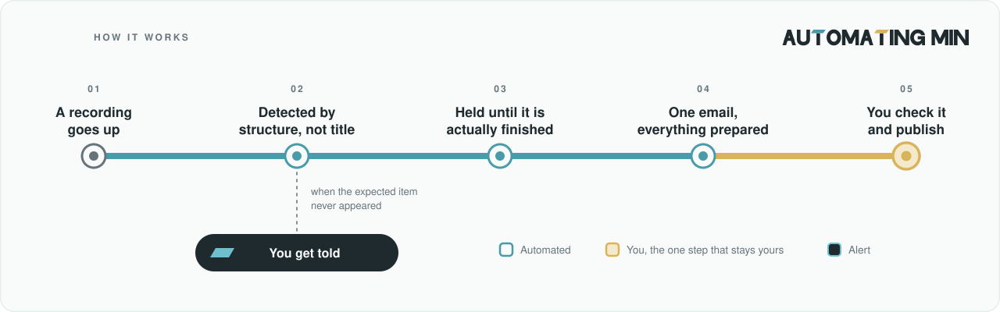

# streamwatch

A recurring event gets recorded, livestreamed, and archived on a video
platform. Then someone has to put it on the organization's own website. That
second step is usually done by hand, by a volunteer, and it usually decays.

This repo is about why it decays and what to do about it.

## Status

The method is in METHOD.md. The source is in `src/`, as a **sanitized
snapshot**: the same logic as the deployed version, with every configured value
replaced by a documented placeholder. Snapshot taken 2026-10-14.

That wording is deliberate, and it is a limitation worth stating plainly. This
repo is not the deployment source. The deployed copy lives in the scripting
environment's own editor, inside the account that owns the schedule, and it is
left alone — making a public repo the deployment source would mean refactoring a
working pipeline for the benefit of a mirror, which is a bad trade against a
thing that currently works every week. So the repo is a snapshot, dated, and
updated when the *logic* changes rather than when a *value* changes. Since
values are what actually change, the two stay close in practice.

The method is what is being shared here. The code is included so the method is
checkable, not so you can run this exact file.

A working version runs weekly in production. It was deployed in August 2026,
has detected and packaged every item since, and has survived three distinct
failure modes that are now documented as design rules in
[METHOD.md](METHOD.md) — a silent detection gap caused by a timestamp that
never updates (§4), a 17-hour delay caused by asserting a fact that was
available in an API response (§8), and the class of failure where a scheduled
job stops and reports nothing (§7).

That version is wired to one organization's channel, backend, field names and
people. Publishing it would mean either publishing those values or publishing a
generalized copy that nobody actually runs — and a second copy of working code
that nobody runs is the thing that drifts out of sync and quietly becomes
wrong. So the method is published first, and the code follows only when the
running instance and the public one can be the same file.

**The honest claim: this method is in production, and the code that implements
it is not in this repo.** See [v1 and v2](#v1-and-what-v2-is-for).

## How it works

<p align="center"></p>

**Teal is automated. Butter is you.** There is one butter station, and it stays
butter on purpose — the publish decision is the gate, not an automation gap
(METHOD.md §5).

Three things in that picture are the whole design, and each has its reasoning in
METHOD.md rather than here:

- **Detected by structure, not by title** — title formats drift, structure does
  not, and a keyword matcher that stops matching looks exactly like a quiet week
  (§4).
- **Held until actually finished** — measured from the real end timestamp, never
  from the publication timestamp, which for a scheduled stream is set at
  creation and never updates (§8).
- **You get told when nothing arrived** — the dangerous failure is silence, not
  error. Nobody investigates an absence unless something points at it (§7).

## Tools

Everything below is free at this volume, and none of it required a new account,
a server, or a credit card. That was a selection criterion, not luck —
METHOD.md §9.

| Tool | Role | Cost |
|---|---|---|
| Google Apps Script | the whole runtime: scheduling, storage, outbound HTTP, mail | free |
| — time-driven triggers | run the check without anyone remembering to | free |
| — `PropertiesService` | persists the handled-ID list between runs | free |
| — `UrlFetchApp` / `XmlService` | fetch and parse the feed and the API | free |
| — `MailApp` | deliver the package | free, within a generous daily quota |
| YouTube channel RSS feed | discovery: what is new | free, no quota |
| YouTube Data API v3 (`videos.list`) | detail: structural metadata for specific IDs | free tier; 1 quota unit per batched call of up to 50 IDs |
| Email inbox | where the package lands; also the task queue | free |
| Destination CMS | final publish — manual, by design | n/a |

Two cost rules worth stating explicitly, because getting them wrong is how this
kind of project acquires a bill:

- **Discovery uses the free feed, never a search endpoint.** A search-style
  query costs on the order of 100× a metadata lookup. The feed answers "what is
  new" for nothing.
- **Detail lookups are batched.** One request covering many IDs costs the same
  as one covering a single ID.

## What is in the repo

```
METHOD.md        the design rules, each with its reasoning
src/Code.gs      the watcher, sanitized
src/test.js      offline tests for the pure logic
docs/flow.svg    the diagram above
```

The tests need no network, no API key and no account:

```bash
cd src && node test.js
```

They cover title normalization, the CJK character class that can fail silently,
tagging, all four readiness states, speaker parsing, event-day derivation, video
id parsing, the handled list, and a reproduction of the real incident that
retired the time watermark.

## The measurement this is built on

The usual framing is "how long does it take". That framing is wrong, and it is
why these workflows get abandoned.

The volunteer who had been doing this by hand was asked directly why she
stopped. She said the steps were easy. Each one individually was easy. What
stopped her was **activation cost**: four web properties, a login, a dozen
tab switches, values copied by hand, and no way to recover your place if
interrupted — which together require a protected block of time that someone
with a full-time job cannot reliably find.

| | measured how | result |
|---|---|---|
| Human actions per item, before | counted from a screen recording of one real item | **~52** |
| Web properties touched | same recording | 4 |
| Browser tab switches | same recording | 12+ |
| Elapsed time | same recording | ~12 min |
| Human actions per item, after | **not yet re-counted** | unknown — see below |

The "after" number is deliberately blank. Estimating it would be easy and
would be worth nothing. It gets filled in when a second screen recording is
counted the same way as the first.

**So count actions, not minutes.** 20 minutes down to 12 is a 40% improvement
that will still be abandoned. 15 actions down to 3 may save five minutes and
will survive, because three actions fit in a gap between other things and
fifteen do not. METHOD.md §2 has the full argument.

## Who does which step, and why

| Step | Who | Why |
|---|---|---|
| Notice that a new recording was published | automation | Structural metadata, not title keywords. Title formats drift; structure does not. METHOD.md §4 |
| Decide whether it has finished settling | automation | Measured from the actual end timestamp, never the publication timestamp. METHOD.md §8 |
| Assemble title, date, duration, embed URL, thumbnail | automation | All of it already exists in one machine-readable record. METHOD.md §3 |
| Normalize the title to a consistent form | automation | Mechanical, and the inconsistency is real |
| Supply facts no system recorded | **you** | A machine can transform information. It cannot create it. METHOD.md §6 |
| **Decide this is the right item and publish it** | **you** | **This is the gate. It is not an automation gap.** METHOD.md §5 |
| Notice that nothing arrived when it should have | automation | The dangerous failure is silence, not error. METHOD.md §7 |

The last row is the one most of these projects leave out, and it is the one
that determines whether the pipeline is still alive in three months.

## What this is honestly worth

**The time saved is small.** A few minutes per week. If you justify a project
like this on hours saved, the numbers will not support it.

**The value is that you no longer have to remember.** The item arrives; you are
not required to check on a schedule, forever. Everything needed is in one
message, so an interruption costs nothing. If it does not arrive when it should
have, you are told — you are not required to notice an absence.

That is a different benefit from "it is faster", and it is the one that decides
whether the work keeps happening. METHOD.md §11.

## What is not in here

No credentials, no API key, no channel identifier, no organization or person
names, no destination schema. The config block in `src/Code.gs` is placeholders
throughout, and the test fixtures are invented.

No write integration with any destination system. The final publish is a human
step by design (METHOD.md §5), not a missing feature.

No deployment tooling. Copying four hundred lines into a script editor once is
not the problem this repo is about.

## v1, and what v2 is for

**v1 is this:** the design rules with the reasoning behind each one, and the
source that implements them, up to the point where a human pastes the package
into the destination.

**v2 is removing that paste**, which is not an engineering problem. It needs the
destination system to expose a write endpoint scoped to *create a draft* — no
publish, no edit, no delete (METHOD.md §5). That is a conversation with whoever
maintains that system, and the scope of the endpoint matters more than the
secrecy of the token. Until that exists, the paste stays, and the package is
built to make it as cheap as possible.

The number that would prove v2 was worth it is the one in the table above that
is still blank: human actions per item, counted the same way as the baseline.

No timeline. It is the next thing, not a promise.

## Licence

MIT.
